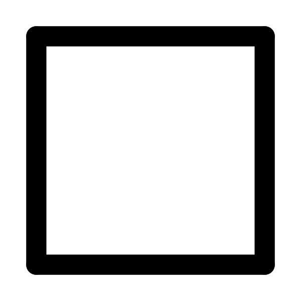
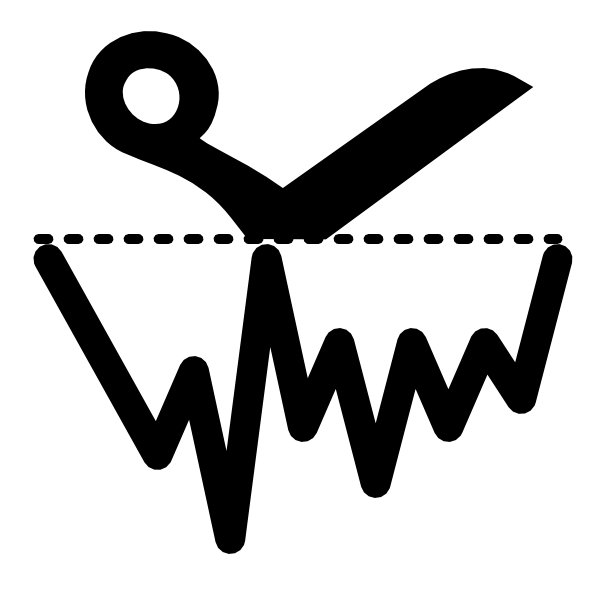
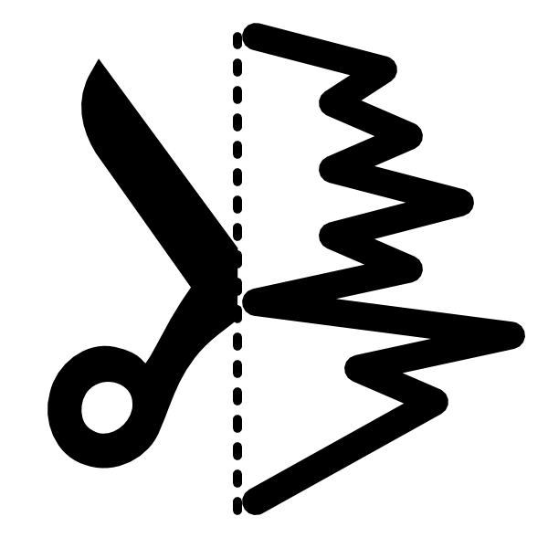

Peaks of a profile (e.g. the lines of a grid, of a ruler or of a spectral comb), their numbering and a polynomial
fit of their positions, to calibrate the scale and the origin of the image in world units.

Typical use
-----------

1. Show the region ( in the toolbar) and put it on the
   peaks: the profile is the mean of the region across the chosen direction.
2. Choose the direction of the profile ( horizontal,
    vertical) and adjust the blur and the prominence until
   the red lines are on the peaks.
3. Write the **Peak spacing** and the position of the **First peak** in world units, then **Calibrate**.

Peak search
-----------

The toolbar has the parameters of the search:

- Direction: the profile along x (the mean of the columns of the region) or along y (the mean of the rows).
- Blur [px]: σ of the gaussian smoothing before the search (0: none). The smoothed profile is the dotted line of
  the plot. A large blur shifts the peaks toward their higher neighbours.
- Prominence [%]: minimum height of a peak above the higher of its two surrounding valleys (the lowest points
  before a higher peak on each side), in % of the range of the smoothed profile. It removes the small maxima of the
  noise.

Each local maximum of the smoothed profile that is prominent enough is a peak (red line), at a sub-pixel position
(parabola through the 3 points around the maximum). A peak on the first or last pixel of the region is not found.
The **Points** tab lists the positions [px] and the values of the peaks.

Pixels that are not finite (NaN) are left out of the means.

Peak numbers
------------

The peaks are numbered from 0 (the first one, left or top) one gap at a time: each gap is counted in units of the
local spacing (the previous gap per number, the median gap for the first one). A missing peak gives a gap of 2 and
the following peaks keep their numbers, and a spacing changing along the profile (e.g. the dispersion of a
spectrometer) is followed. A spurious peak between two real ones still counts as one number and shifts the
following ones: increase the blur or the prominence.

Calibration
-----------

A linear fit of the positions against the numbers gives the spacing of the peaks [px] and the position of the first
peak [px] (shown next to the values):

- **Peak spacing**: the distance between two consecutive peaks in world units (e.g. mm, nm). The scale of the image
  is spacing / fitted spacing [units/px].
- **First peak at**: the world coordinate of the first peak found. The origin of the image is
  fitted first peak − value / scale [px], with the scale from the peak spacing (it does not need **Set scale**
  first).
- **Set scale**, **Set origin**: set only the scale or only the origin of the image, along the direction of the
  profile. **Calibrate** sets both.

The scale of an image is linear: if the spacing changes along the profile, the scale is the mean one (use the
polynomial fit for a non linear axis). The first peak is the first one *found*: if the real first peak is outside
the region or too weak, the origin is wrong by whole spacings (check the red lines).

The region stays on the same pixels when the origin changes.

Polynomial fit
--------------

The line below the plot: the **Order** of the fit, its coefficients c₀ c₁ ... (from the order 0) and the direction
of the fit:

- unchecked: the position [px] as a function of the peak number, pos = c₀ + c₁·n + c₂·n² + ...
- **Fit number(position)**: the peak number as a function of the position,
  n = c₀ + c₁·pos + c₂·pos² + ...: e.g. a non linear calibration of the axis.

The status bar shows the number of points, the covariances of the linear fit and its residual.

**Fourier** is an independent estimate from the dominant frequency of the (not smoothed) profile: the period [px]
and the position of the first maximum of the corresponding sinusoid. For a regular comb it should agree with the
fitted spacing and first peak.

Toolbar
-------

- : shows the region.
- : copies the peaks (number, position, value) to
  the clipboard.
- : exports the peaks to a text file.
