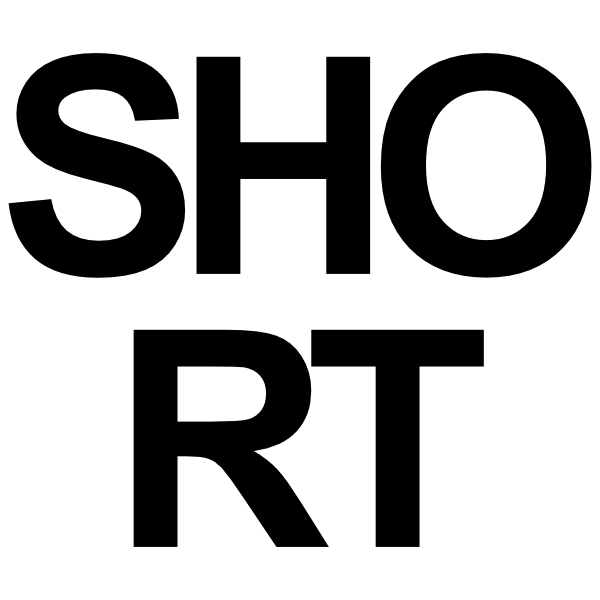
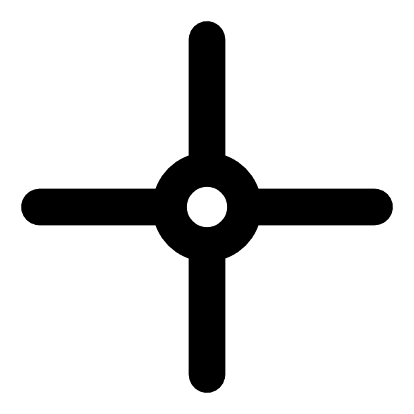
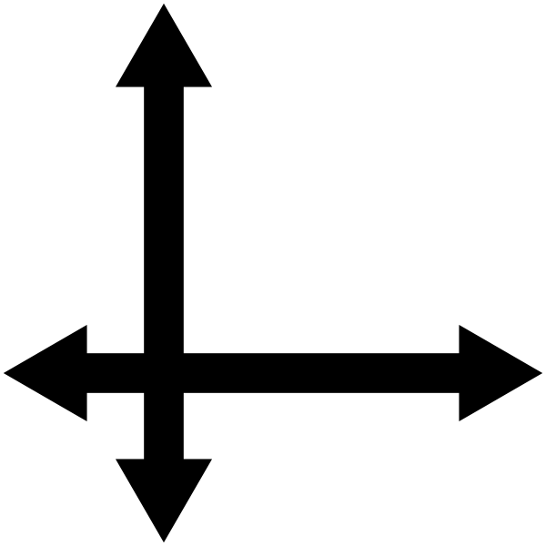
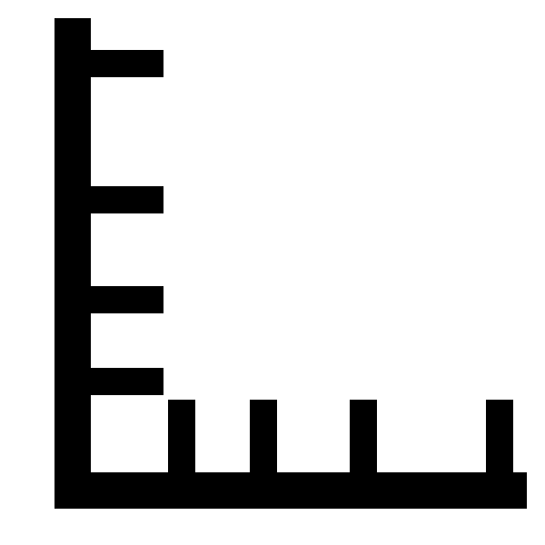
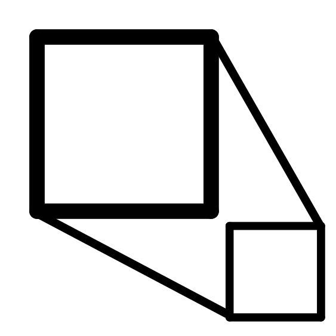

The list of the open images, with their short name, scale, origin and name. Choosing a row shows the image (the
field below the list is the file it comes from); the slider goes through the images in their order.

- Several rows can be selected (shift, ⌘/ctrl): the buttons act on all of them.
- Enter shows the selected image, Delete (or Backspace) closes the selected ones.
- A click on a column header sorts the list, and the order of the images too (the slider, the next/previous image).
- The rows can be dragged (e.g. onto another Neutrino window).

Toolbar
-------

- : duplicates the selected images.
- : closes them.
- , : changes the short name (in the list and
  the menus) or the name (the file, the title).
- : the origin, in pixels (`x y`): the zero of the world
  coordinates.
- : the scale, the size of a pixel in world units (`s`, or
  `sx sy`). It replaces the non-linear scale of the axis whose value changes.
- : the **non-linear scale** (below).
- : a resized copy (`factor`, or `width height`).

Non-linear scale
----------------

When the world coordinate is not proportional to the pixel (e.g. the dispersion of a spectrometer, the sweep of a
streak camera, the distortion of an optic), each axis can be a polynomial of the pixel:

    P(p) = c0 + c1·p + c2·p² + ...

with p the pixel counted from the left (x) or top (y) border of the image, whatever the origin. With the origin at
0 the world coordinate is P(p): e.g. `400 0.2 1e-4` gives λ = 400 nm on the first pixel. With another origin it is
P(p) − P(origin) + c0: c0 is the value at the origin, and moving the origin only shifts the values (the polynomial
belongs to the detector, not to the zero).

- The coefficients are separated by spaces or `;`. Empty: linear axis. One degree: the scale c1, with the origin
  moved so that the value is c0 at the old origin.
- The polynomial must be monotonic over the image, otherwise it is refused.
- The rulers (their ticks are at round world values, not evenly spaced), the mouse coordinates, Mouse_info, the
  lineouts (horizontal, vertical, both, box, compare lines) and the size of the box use the polynomial.
- The other tools use the **linear approximation**: the scale shown with ≈ in the list is the mean slope over the
  image, (P(W) − P(0))/W. With a moderate distortion, their error is of the order of the distortion.
- The polynomial is saved with the image (`.neus`, `.tif` by Neutrino) and follows the crops, the flips and the 90˚
  rotations; an arbitrary rotation or another file format keeps only the linear approximation.

It can also be set in the Scale fields of Mouse_info (`c1 c2 ...` instead of a single number: there the origin
has its own field, c0 is not written and is kept) or by Find_peaks
(**Set non-linear scale**, from the peaks of a calibration spectrum).

From Python: `image.scalePoly = ([c0, c1, c2], [])` (x, y), `image.toWorld(x, y)`, `image.toPixel(wx, wy)`.
