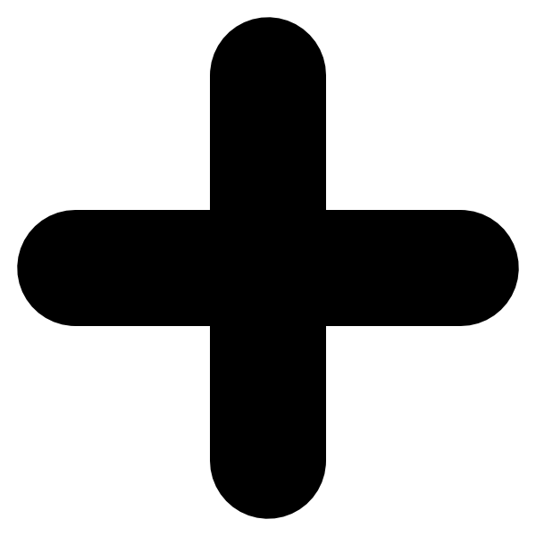

Analysis of the streak images of one or more VISARs (velocity interferometers) and of the SOP (streaked optical
pyrometer): fringe shift, velocity, reflectivity and temperature as functions of time.

The window has 4 tabs on the left:

- **Settings**: the parameters of each VISAR that are set once (images, region, carrier, intensity, sweep).
- **Velocity**: the parameters of the velocity (delay, offset, reflectivity, jumps) and the plot of all the VISARs.
- **Temperature**: the SOP.
- **Notes**: free notes and the etalon calculator.

The VISARs are tabs in **Settings** and **Velocity**:  adds
one,  removes the current one.

The image is read along its time axis: the fringes are vertical (time along y) or horizontal (time along x),
from the orientation of the carrier.

Settings
========

For each VISAR:

- **Reference and Shot**: the reference image (without the shock) and the shot image, of the same size. The **...**
  button shows the region (ROI) of the analysis on the image: the phase and the intensity are averaged over the
  width of the ROI, and the error of the phase is their spread across it.
- **ghost**: removes the ghost fringes (e.g. from a window in front of the target) inside a region of the shot
  (**...** shows it). In the region, the fringes at the frequency of the carrier are removed from the shot: where
  the target does not reflect anymore, the ghost fringes would be taken for the signal. The check box has three
  states: unchecked (nothing removed), checked (removed), partially checked (removed, and the image of the shot
  without ghosts is shown).
- **Carrier**: interfringe [px] and orientation [˚] of the fringes (0˚: vertical).
   guesses them from the Fourier transform of the ROI of the reference: adjust
  the **weight** if the values are not correct (< 0 prefers the lower frequencies, > 0 the higher ones).
- **Center & Magnification**: the pixel of the target centre (TCC) and the size of a pixel, for the positions in
  space (shown in the status bar when the mouse is on the image).
- **Slit** [px]: width of the filter along the time direction (the temporal resolution: e.g. the height of the
  slit of the streak camera in focus mode). The intensity is also blurred over half of it.
- : filters this VISAR (a warning icon on the button, the tabs and the toolbar
  tells that a parameter changed and the filter must be done again).

The filter is a gaussian around the carrier in the Fourier space (along the carrier: one interfringe, across it:
the slit). It gives the phase, the contrast and the intensity (the image without the fringes) of the reference and
the shot; the phase of shot − reference is unwrapped (guided by the quality, the product of the contrasts).

**Intensity parameters** (offset, shift, ref*, border):

- **offset**: the background level (dark value), subtracted from the reference and the shot. Read it on the image
  (e.g. long after the shock, or on the side without fringes).
- **shift** [px]: the time delay of the reference with respect to the shot (probe jitter).
- **ref\***: multiplication factor of the reference: to put the intensity of the reference (dashed blue line) at
  the level of the shot (solid line) before the shock, against the shot-to-shot fluctuations of the probe energy.
  Mandatory for the reflectivity.
- **border** [px]: for each time, the mean of the intensity on this many pixels at both sides of the region is
  subtracted (a background varying in time). 0: off.

**Visar sensitivity** [velocity/fringe]: the velocity of one fringe of shift. The **Notes** tab has a calculator
from the parameters of the etalon.

**Sweep time**: the calibration of the streak, the time of the pixel X as a polynomial of coefficients
A<sub>1</sub> ... A<sub>n</sub> (separated by spaces or ;):

- **Hamamatsu**, as defined by the Hamamatsu cameras:
  T(X) = A<sub>1</sub>X + A<sub>2</sub>X²/2 + A<sub>3</sub>X³/3 + ... + A<sub>n</sub>X<sup>n</sup>/n
- **Normal**:
  T(X) = A<sub>1</sub>X + A<sub>2</sub>X² + ... + A<sub>n</sub>X<sup>n</sup>

One value is a linear sweep. A negative A<sub>1</sub> means a time going backwards with the pixel.

**To image** sets the axes of the reference and shot images to those of Visar: the rulers, the mouse,
Mouse_info and the lineouts then show its time and space.

- The time (vertical or horizontal, from the angle of the fringes): the sweep, with the time zero and the offset of
  the **Velocity** tab, T(X) − T(zero) + offset. A non-linear sweep becomes the non-linear axis of the images (see
  Image_list) and their origin along the time stays; a linear one is a scale, and the origin moves to the pixel
  where the time is 0. A sweep that is not monotonic over the image is refused (the space is still set).
- The space (the other axis): linear, origin at the **Center** and scale the **Magnification**.

The objects of Visar (regions, masks) keep their pixels when the origin moves.

The plot shows the fringe shift (the phase of the shot, averaged over the ROI), the intensities and the contrasts
of the reference (dashed) and the shot (solid) as functions of the pixel; the fringe shift is also drawn on the
image.

Velocity
========

For each VISAR:

- The check box enables the VISAR (plot, export, shot change).
- **Delay & t0**: the delay of the shot and the pixel of the time zero: the time is T(X) − T(t0) + delay.
- **Fringe offset**: the shift is set to 0 at the beginning of the sweep (the automatic offset is written in the
  title); the spin box adds an offset, in fraction of fringe (e.g. when the velocity before the shock is not 0).
- **Reflectivity (ghost & material)**: the reflectivity is
  R = (I<sub>shot</sub>/I<sub>ref</sub>)·(R<sub>mat</sub> − β) + β, with β = −R<sub>g</sub>/(1 − R<sub>g</sub>)²:
  R<sub>mat</sub> (right box) is the reflectivity of the material (of the target before the shock) and
  R<sub>g</sub> (left box) the reflectivity of a ghost (e.g. a window in front of the target).
- **Jumps** `t i [n0];`: the fringe jumps, which the phase cannot see (a fast change of velocity, e.g. at the shock
  breakout). Each jump is a time `t` (in the units of the time axis), a number of fringes `i` and optionally the
  refractive index `n0` of the medium after it (1 by default), separated by `;`. The jumps add up: after the time
  of a jump the velocity is (offset + shift + all the jumps before) × sensitivity / n0. E.g. `0 3; 3.5 5 1.7` is a
  jump of 3 fringes at the time 0, then 5 more at 3.5 in a medium of index 1.7. With two VISARs of different
  sensitivities, the right jumps are the ones that give the same velocity.
- The spin box next to the jumps draws the velocities with 1, 2, ... more fringes (negative: fewer), to find the
  jumps.
- **R** and **Q**: show the reflectivity and the quality (contrast of the shot / contrast of the reference).

The plot shows the velocities (with the errors from the spread of the phase over the ROI), the reflectivities and
the qualities of all the VISARs: the current one with solid lines, the others dashed. The jumps are the vertical
lines.

Temperature
===========

The SOP is the mean over a region (**...** shows it, the check box enables the SOP) of the shot minus the
reference, along time:

- **Reference and Shot**: the SOP images. With the reference equal to the shot nothing is subtracted: use
  **Offset**.
- **Offset** [counts]: the background, subtracted from the counts.
- **Time zero and delta t**: the pixel of the time zero and the delay, as for the VISARs.
- **Center & magnification**: as for the VISARs.
- **Sweep time** and direction: the sweep, as for the VISARs, and the direction of the time (**V**ertical or
  **H**orizontal); **To image** sets it as the time axis of the SOP images, as for the VISARs.
- **Refl.**: the reflectivity R of the temperature: **Zero** (no reflectivity: blackbody temperature), **Mean** of
  the VISARs at the same time, or a single VISAR.
- **SOP calibration T0 A**: T<sub>0</sub> is the colour temperature of the light collected by the optics (the
  filters) and A the efficiency of the streak. The temperature is
  T = T<sub>0</sub> / ln(1 + (1 − R)·A / counts).

Notes
=====

A free text, saved with the settings, and the **Etalon calculator**: from the wavelength λ, the thickness e, the
refractive index n of the etalon and its dispersion dn/dλ:

- the sensitivity λ / (2τ(1 + δ)) [km/s per fringe], with τ = 2e/c·(n − 1/n) and δ = −λ n/(n² − 1)·dn/dλ,
- the displacement e(1 − 1/n) [mm] of the mirror (to compensate the image of the etalon).

Toolbar
=======

-  / :
  adds or removes a VISAR.
- : filters all the VISARs that need it.
- : exports the curves of the current tab (the current
  VISAR or the SOP) to a text file, with the parameters in the header.
- : exports all the VISARs and the SOP.
- : copies the curves of the current tab to the
  clipboard (all the VISARs in **Velocity**).
- : copies the image of the plot of the current tab.

The mouse on the image shows the time and the position in the status bar; drag with the mouse to measure a delay
and a distance.

Shot number change
==================

To go from one shot to another, fill for each VISAR (in **Settings**) and for the SOP the directory and the
*RegEx* pattern of the references and of the shots. E.g. with the files:

```
Visar_2_001_ref.img
Visar_2_001_shot.img
Visar_2_002_ref.img
Visar_2_002_shot.img
...
Visar_2_051_ref.img
Visar_2_051_shot.img
```

the reference pattern is `Visar_2_(\d+)_ref.img` and the shot pattern `Visar_2_(\d+)_shot.img`: `(\d+)` matches
the number of the shot ("one or more digits"). The button
 next to the patterns guesses the directories and
the patterns from the current images (it replaces the numbers of at least 2 digits).

The combo of the toolbar then lists the shot numbers found for all the enabled VISARs and the SOP: choosing a number
closes the current images, opens the reference and the shot of that number and filters them. The arrows go to the
previous and next number. If files are added to the directories,
 in the toolbar updates the list.
