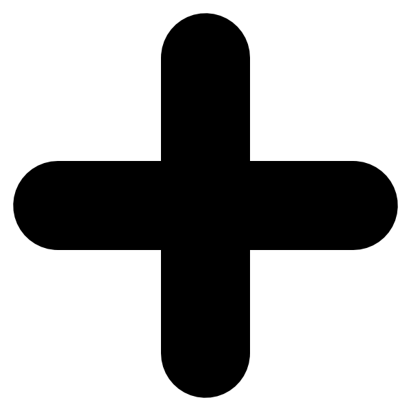
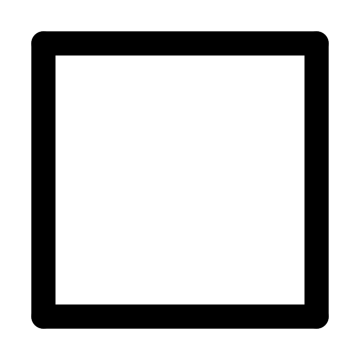
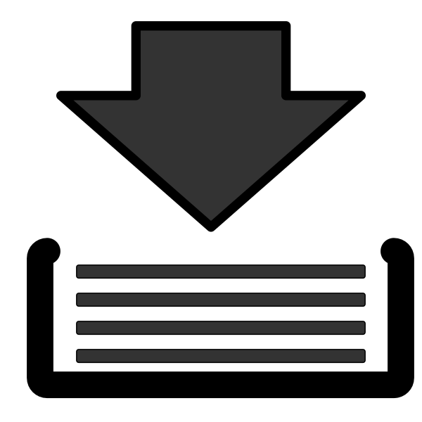
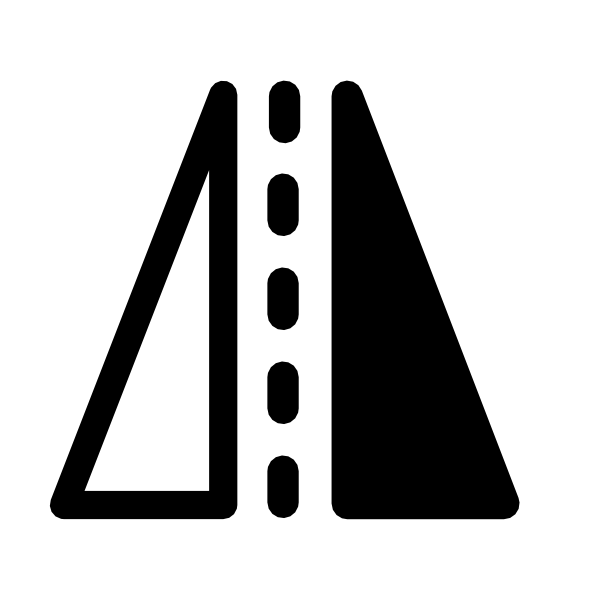
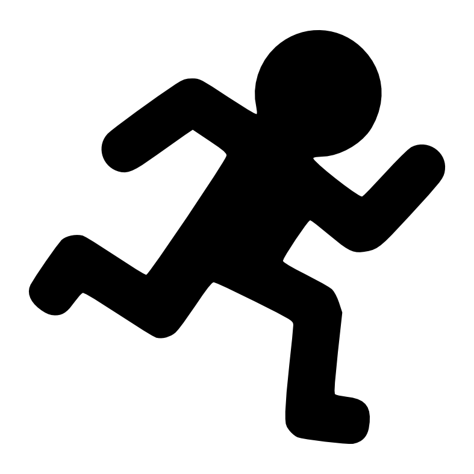

Cuts the image plates (IP) out of one scanned image (e.g. several IPs scanned together, or the parts of an XRD
setup on one plate): each IP is a region of the scan, rotated and flipped to a common orientation, optionally
corrected for the fading of the signal, and saved as its own image.

Typical use
-----------

1. Choose the scan in **Source** ( shows it: the regions of
   the IPs are visible only on the source).
2. Add an IP for each plate () and put its region on it
   ( in its tab shows the window of the region).
3. Give each IP a name (double click on its tab), and the rotation and flips that put it in the right orientation.
4. Save all the IPs ().

The settings (regions, names, orientations) are kept by the pan: the next scan of the same setup is cut the same
way.

IPs
---

Each tab is an IP. Its image is named as the tab and is updated each time its region or its orientation changes;
the tab shows it when chosen.

- Rotation [˚]: counterclockwise. 90, 180 and 270 are exact; any other angle interpolates and enlarges the image
  (the corners outside the region are NaN).
-  flip left/right,
   flip up/down,
   transpose: applied after the rotation, in this order.
- : the window of the region (its corners).
- : crops again and shows the image of the IP.
- : saves the image of this IP only.

The name of an IP (double click on its tab) is the name of its image and of its saved file. The cropped images
have scale 1 and origin 0 (pixels of the IP).

Fading
------

The signal of an IP decays between the exposure and the scan. With a **Scan delay** > 0 [min] the images are
divided by the fraction of the signal left after that time, for the **IP model** (Fuji BAS MS, TR, SR, ND, MP):

    f(t) = A₁ exp(−t/B₁) + A₂ exp(−t/B₂)

| model | A₁ | A₂ | B₁ [min] | B₂ [min] |
|---|---|---|---|---|
| MS | 0.334 | 0.666 | 107.32 | 33974 |
| TR | 0.535 | 0.465 | 28.812 | 3837.2 |
| SR | 0.579 | 0.421 | 15.052 | 3829.5 |
| ND | 0.559 | 0.441 | 18.179 | 3907.0 |
| MP | 0.565 | 0.435 | 18.461 | 6117.5 |

E.g. a TR plate scanned after 60 minutes keeps 52% of its signal: the image is multiplied by 1.91 (and its colour
range too). The correction is for a signal proportional to the dose (PSL, as opened by Neutrino from the Fuji
scanner files), not for the raw values of the scanner (logarithmic).

Toolbar
-------

- : saves all the IPs, and the settings of the pan next to
  them (a `.ini` file, to reload with **Load preferences** at the right of the toolbar):
  - **dir** unchecked: a file name is asked; each IP is `<name>_<IP name>.<extension>` with that extension, and
    the settings `<name>.ini`.
  - **dir** checked: a directory is asked (it can be created in the dialog); each IP is
    `<directory name>_<IP name>.tif`, and the settings `<directory name>.ini`.
- : crops all the IPs again (e.g. after changing the scan
  delay or the source).
- : closes the images of all the IPs and shows the source.
-  adds an IP,
   removes the last one (and closes its image).
