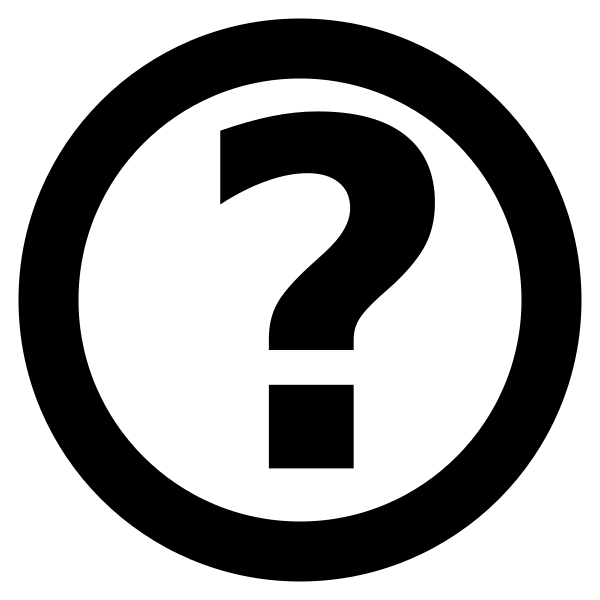
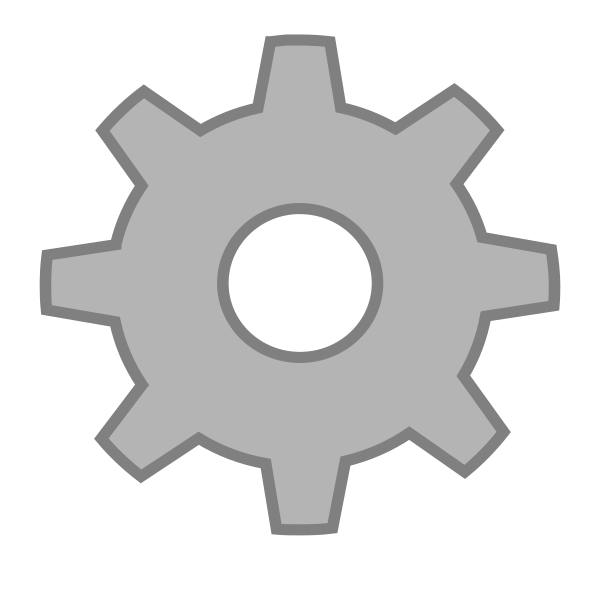
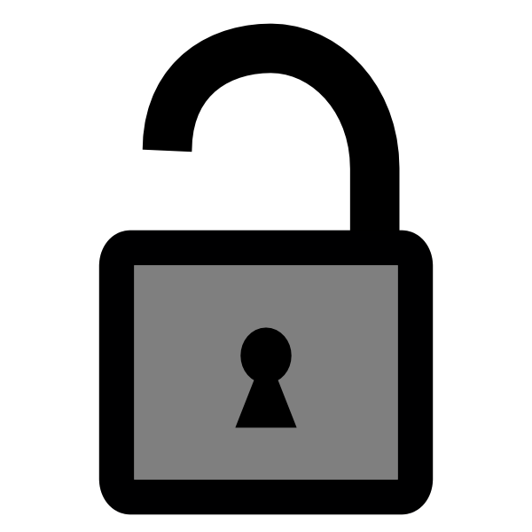
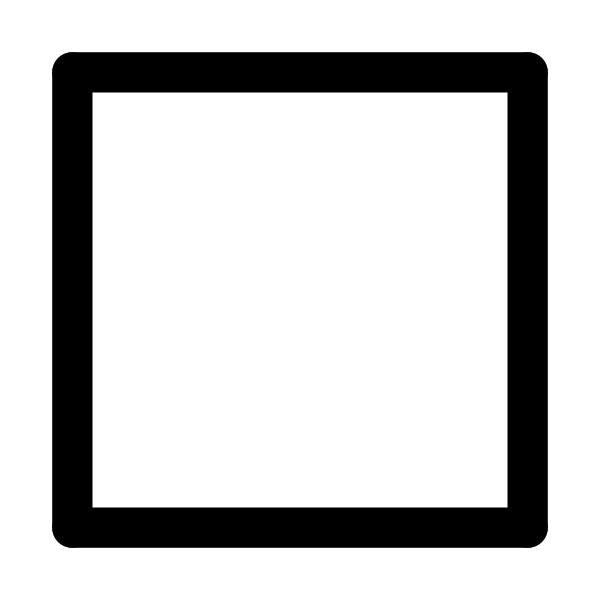
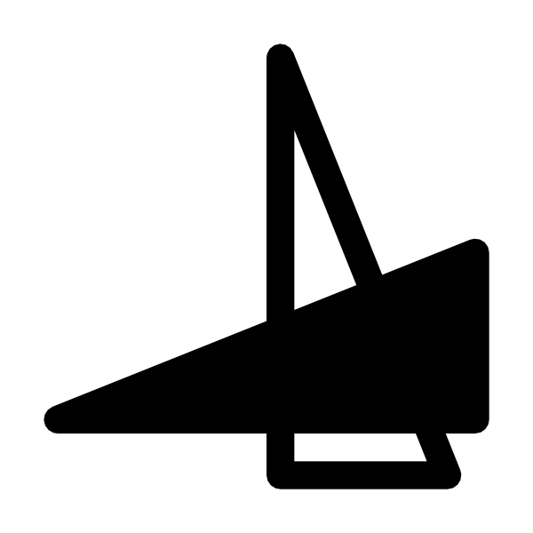
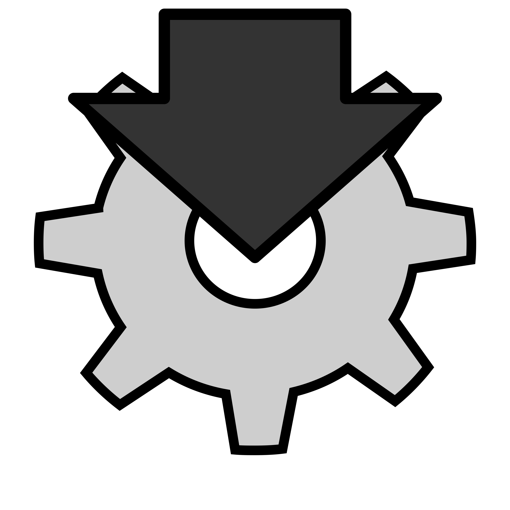
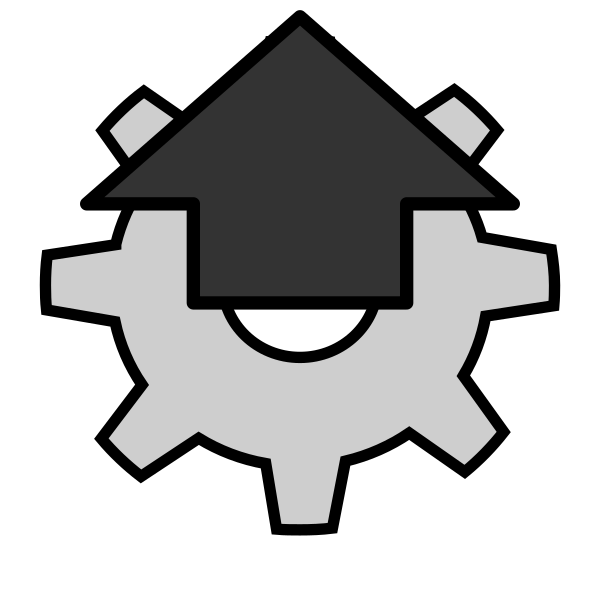

Neutrino shows and analyses images of physics experiments (cameras, image plates, interferograms, spectra...):
each image keeps its values (not only a picture), with a world scale and origin, and the analysis tools work on
them.

This help has a page for each tool that has one, listed on the left by menu. The search field shows only the pages
containing a text.  at the right of the toolbar (or F1) opens this help; in a tool,
**Help** in its  menu (or F1) opens its page.

In the shortcuts, Ctrl is ⌘ on macOS. All of them are on the page [Keyboard shortcuts](help/keyboard_shortcuts.html)
(Ctrl+K), made from the menus of the window.

Images
------

- **File → Open** (Ctrl+O), or drag the files on the window: the images of the usual formats (tif, png, jpg...),
  of the scientific ones (fits, hdf, the Fuji image plate scanners `.inf`, SPE, SIF, PCO...) and the sessions
  (`.neus`). **Open RAW**
  (Ctrl+Shift+O) reads a file of raw numbers, given the size and the type.
- **Save Image** (Ctrl+S) saves the image with its values (tif, fits, hdf5...). **Export** (Ctrl+E) saves what is
  seen (the colours); **Export all** (Ctrl+Shift+E) all the images.
- **Save Session** (Ctrl+Shift+S): all the images, the objects and the open tools in one `.neus` file, opened again
  as it was.
- A window holds several images: **Image → Buffers** (Ctrl+Up, Ctrl+Down) goes through them, Ctrl+D closes the one
  shown. The list of the images (and their scale, origin, names) is
   **Image list** (Alt+I).
- **File → New** (Ctrl+N) opens another window.

View
----

- Zoom: +, −, = (fit), Ctrl+wheel, or a pinch on a touchpad.
- The mouse shows its position and the value of the pixel in the status bar. The arrows move the mouse cursor by
  a pixel (with Shift by 5), Return records the point (in **Mouse info**). **Image → Change mouse** (Ctrl+M) changes
  its shape.
- **Show/Hide ruler** (Ctrl+R) and **grid** (Ctrl+G): in world units.
- **Copy pixmap** (Ctrl+C) copies what is seen to the clipboard.

Colours
-------

- **Colortable**: Ctrl+Left and Ctrl+Right change the palette, **Colorscale** (Ctrl+Alt+C) chooses it and the range.
- **Rescale 99.9%** (Ctrl+9) puts the colour range on 99.9% of the pixels, Ctrl+[ and Ctrl+] show less or more
  of them, **Rescale reset** (Ctrl+A) the whole range. With Alt: all the images.
- Ctrl+drag on the image: the colour range of the pixels under the mouse.
- Gamma: > and <, . resets it.
-  in the toolbar locks the colours: the next image shown takes the
  colour range and the gamma of the current one.

World coordinates
-----------------

Each image has an origin [px] and a scale [units/px] along x and y, used by the rulers, the mouse and the tools.

- **Image → Set origin** (Ctrl+0): the origin at the mouse (Ctrl+Shift+0: for all the images).
- The origin, the scale and the units can be written in **Mouse info** or in **Image list**; **Find peaks**
  calibrates them from the peaks of a grid or of a spectrum.
- An axis can be **non linear**, a polynomial of the pixel (e.g. the dispersion of a spectrometer): see
  **Image list**.

Objects
-------

**Image → Paths** (and  in the toolbar): lines, rectangles, points and
ellipses on the image, also used by the tools (lineouts, regions...). Tab goes through them.

- Drag an object or its points with the mouse; the arrows move the one with the focus (with Shift by 10).
- A double click (or W, or the menu of the right button) opens its window: position, size, colour, save and load.
- A line: A and P add a point at the end or at the start, D removes the last one, C closes it, B makes it a
  Bézier curve, X and Y make it horizontal or vertical, R a rectangle.
- A rectangle: X, Y or E expand it to the width, the height or the whole image.
- Backspace deletes the selected object (the objects of a tool close it, after a confirmation).

Image operations
----------------

**Image → Transform**: rotations by 90˚, flips, transpose (also  in
the toolbar). The other operations (crop, rotation by any angle, mathematics between images...) are in the menu
**Analysis**.

The tools
---------

The tools (menus **Analysis**, **Image**, **File**) are windows working on the image shown, and they follow it
when it changes. **Window → Open by name** (Ctrl+X) opens one by its name. At the right of their toolbar:

-  : load and save
  their settings in a file. The settings are kept from one time to the next anyway; opening a tool holding Alt (or
  **Reset** in the menu below) starts again from the default ones.
- : **Help** (their page of this help, F1), **Copy as Python** (the commands that set the values of the window),
  **Show widget names** (their names for Python), a screenshot of the window.

Python
------

The `neutrino` module (`pip install neutrino-toolkit`) opens Neutrino windows from Python, with the images as
numpy arrays and the tools driven by script: `win.openPan("Find_peaks")`, then `pan.set(name, value)`,
`pan.button(name)`... with the names of the widgets ( → **Show widget
names**, or **Copy as Python** for all the values of a tool).
